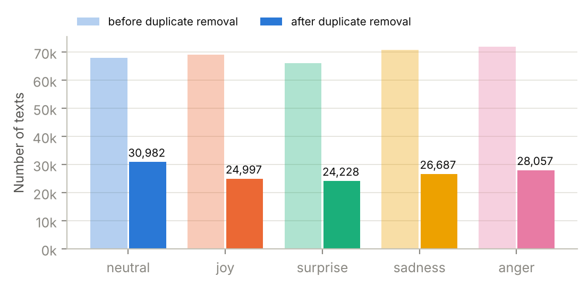
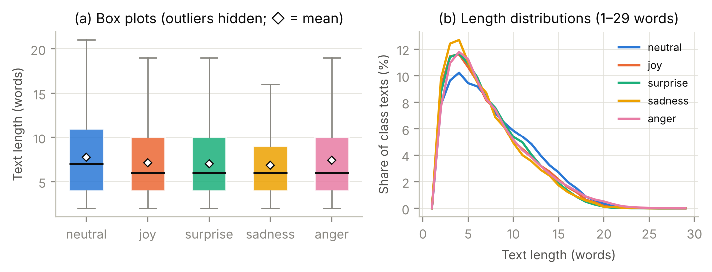
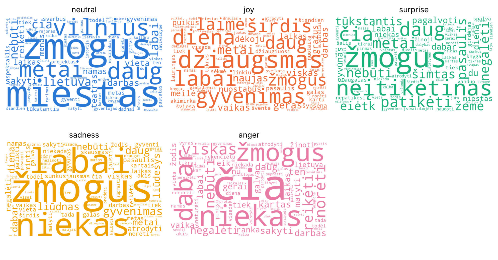

Natural Language Processing — Laboratory Work No. 5

Emotion Classification Using Machine Learning

Text analysis and Logistic Regression classification of the Lithuanian Emotional Speech Corpus (EMO) transcripts

<b>Abstract.</b> This work studies five-class emotion classification (neutral, joy, surprise, sadness, anger) of Lithuanian texts. Transcripts of the Lithuanian Emotional Speech Corpus (EMO) were turned into a dataset of 134,951 unique single-label texts after excluding 263 texts with multiple emotion labels and removing duplicates. Text length hardly differs between emotions, while vocabulary and part-of-speech distributions do: neutral texts are noun-heavy news sentences, joy and sadness contain explicit emotion words, and anger is conversational, with almost three times more pronouns than neutral text. Three representations were compared as inputs to Logistic Regression: TF-IDF, FastText embeddings trained on the training set, and multilingual Sentence-BERT embeddings. TF-IDF performed best (accuracy and macro-F1 0.946), ahead of FastText (0.635 / 0.631) and Sentence-BERT (0.620 / 0.617). The embedding models mostly confused sadness and surprise with anger. However, nearly half of the test texts have a near-duplicate transcription in the training set, which inflates the TF-IDF score; on texts without a close training neighbour, accuracy drops to 0.64 for TF-IDF and about 0.48 for the embeddings.

Student: [Name Surname] Group: [Group] Lecturer: [Lecturer]

[University], [City] — 2026

# 1. Introduction

The aim of this work is to investigate emotion classification of Lithuanian text. The transcripts of the Lithuanian Emotional Speech Corpus (EMO) were turned into a five-class text dataset (neutral, joy, surprise, sadness, anger), the linguistic properties of the classes were analysed, and three text representations — TF-IDF, FastText word embeddings and Sentence-BERT embeddings — were compared as inputs to a Logistic Regression classifier. All processing was done in Python (pandas, spaCy, gensim, sentence-transformers, scikit-learn); the code is given in the Appendix.

# 2. Dataset preparation

`metadata.csv` contains one line per recording in the form `wav path | speaker id | transcript`. The emotion is encoded by the first directory of the path: **Z** = neutral, **D** = joy (*džiaugsmas*), **N** = surprise (*nustebimas*), **L** = sadness (*liūdesys*), **P** = anger (*pyktis*). Because the same sentence is read by several speakers, transcripts repeat many times. The preparation steps and their effect are summarised in Table 1.

Table: Table 1. Dataset preparation statistics.

| Step | Count |
|:--|--:|
| Recordings (rows) in `metadata.csv` | 349,696 |
| Unique transcripts | 135,214 |
| Texts associated with more than one emotion label (excluded) | **263** (244 with 2, 14 with 3, 5 with 4 labels) |
| Recordings belonging to these multi-label texts | 3,548 |
| Text samples **before** duplicate removal | **346,148** |
| Text samples **after** duplicate removal (final dataset) | **134,951** |

A text was treated as multi-label if the identical string occurs in folders of different emotions — such a sentence carries no emotion of its own (e.g., a short phrase read in several emotional styles), so it was removed entirely. Removing exact duplicates afterwards reduced the dataset by 61 %, leaving 134,951 unique texts, saved as `emo_text_dataset.csv`. Figure 1 shows the class distribution before and after duplicate removal: the final dataset is reasonably balanced, from 24,228 surprise texts (18.0 %) to 30,982 neutral texts (23.0 %); joy has 24,997 (18.5 %), sadness 26,687 (19.8 %) and anger 28,057 (20.8 %). Neutral texts were repeated by fewer speakers, so they shrink least.

{width=58%}

# 3. Text analysis

**Text length.** All texts are short (2–28 words, mean 7.3), and the length distributions of the five classes almost coincide (Figure 2). Neutral texts are slightly longer (mean 7.7 words) and sadness texts the shortest (6.8), so length alone is a weak cue for emotion.

{width=72%}

**Vocabulary.** Texts were lemmatised with the spaCy Lithuanian model `lt_core_news_md`, and punctuation and stop words (the spaCy list plus the modal verbs *būti, galėti, turėti, tapti*) were removed. General words such as *žmogus* 'person', *daug* 'many' and *labai* 'very' are frequent in every class (Figure 3), but each class has a clear signature (Table 2, ranked by weighted log-odds against the other classes). Joy and sadness use explicit emotion words, surprise mixes disbelief (*neįtikėtina, oho*) with facts about nature and numbers, anger is conversational (*čia, eik*, insults), and neutral texts are news and culture reports. Sadness and anger share the most frequent vocabulary (Jaccard index of the top-100 lemmas 0.37), while anger and neutral share the least (0.21).

Table: Table 2. Most distinctive lemmas of each class (top 5), with English glosses.

| Neutral | Joy | Surprise | Sadness | Anger |
|:--|:--|:--|:--|:--|
| vilnius | džiaugsmas 'joy' | neįtikėtinas 'incredible' | niekas 'nothing' | čia 'here' |
| miestas 'city' | širdis 'heart' | patikėti 'believe' | mintis 'thought' | eik 'go (imp.)' |
| teatras 'theatre' | diena 'day' | pagalvoti 'think' | liūdnas 'sad' | dabar 'now' |
| menas 'art' | laimė 'happiness' | žemė 'earth' | skausmas 'pain' | norėti 'want' |
| projektas 'project' | geras 'good' | augalas 'plant' | liūdesys 'sadness' | niekas 'nothing' |

{width=100%}

**Part-of-speech distribution.** Neutral texts are the most nominal (34.3 % nouns, Figure 4). Towards anger the share of nouns falls (to 20.6 %) and pronouns rise: anger has 15.3 % pronouns, almost three times more than neutral (5.5 %), reflecting direct address (*tu, tave*). Joy has the most adjectives (10.9 %), and sadness and anger the most verbs and adverbs. Because the transcripts are lower-case, the tagger misses many proper nouns and makes some lemma errors (e.g. *eik* → *eiėtk*); these errors are similar across classes.

{width=88%}

# 4. Text representations

The data were split into training (80 %, 107,960 texts) and test (20 %, 26,991 texts) sets with stratified sampling. All data-dependent steps (TF-IDF vocabulary and IDF, FastText training, scaling, choice of *C*) used only the training set. One method was chosen from each category:

1. **TF-IDF** of word uni- and bigrams of the raw text — a strong, transparent baseline. Raw word forms were kept because inflection and pronouns are useful cues (Figure 4).
2. **FastText** (300-d skip-gram, character 3–6-grams) trained on the training texts; a text vector is the mean of its word vectors. Sub-word n-grams suit highly inflected Lithuanian and cover unseen word forms.
3. **Sentence-BERT** — the pretrained multilingual `paraphrase-multilingual-MiniLM-L12-v2` (supports Lithuanian), giving a 384-d sentence vector; used without fine-tuning.

Table: Table 3. Comparison of the text representations.

| Property | TF-IDF | FastText | Sentence-BERT |
|:--|--:|--:|--:|
| Dimensionality | 126,679 | 300 | 384 |
| Sparsity (share of zeros) | 99.99 % | 0 % | 0 % |
| Non-zero values per text | 12.4 | 300 | 384 |
| Semantic information | none (exact words) | mostly morphological | sentence meaning |

TF-IDF is huge and sparse, and treats different forms and synonyms of a word as unrelated. The embeddings are dense and ~330× smaller. FastText's nearest neighbours are mostly forms of the same word (*džiaugsmas* → *džiaugsmai, džiaugsmui*) or words with the same ending (*miestas* → *sviestas*), so its semantics is shallow. Only Sentence-BERT captures the meaning of the whole sentence.

# 5. Emotion classification

A Logistic Regression was trained for each representation on the same training set (*C* chosen on a validation part of it) and tested on the same test set. Results are in Table 4 (macro averages) and the confusion matrices in Figure 5.

Table: Table 4. Classification results on the test set.

| Representation | Accuracy | Precision | Recall | F1-score |
|:--|--:|--:|--:|--:|
| TF-IDF | **0.946** | **0.946** | **0.945** | **0.946** |
| FastText | 0.635 | 0.635 | 0.630 | 0.631 |
| Sentence-BERT | 0.620 | 0.621 | 0.616 | 0.617 |

{width=94%}

**TF-IDF performs best by a wide margin**, and its few errors (≤ 2 % per class pair) are spread evenly. FastText and Sentence-BERT make similar errors: neutral and anger are the easiest classes, while surprise and sadness are the hardest (F1 0.55–0.58). The most common errors are sadness→anger and surprise→anger (15–16 %), surprise→neutral (~14 %) and joy→neutral (~13 %). This matches the text analysis: sadness and anger share negative vocabulary, and surprise and joy without explicit emotion words resemble neutral sentences. Short texts are the hardest: for 1–3-word texts accuracy is 0.85 (TF-IDF) and 0.48 (Sentence-BERT).

TF-IDF's score is inflated by **near-duplicates**: the same sentence read by different speakers was transcribed slightly differently, so exact duplicate removal misses the variants and they end up in both sets. 47.8 % of test texts have a training text with character-similarity ≥ 0.9, and just copying the label of the most similar training text gives 95.6 % accuracy. On test texts without a close training neighbour, accuracy is 0.64 for TF-IDF and ~0.48 for the embeddings. TF-IDF thus remains best, but its realistic accuracy on new texts is closer to 0.6. The embeddings are weaker because averaging dilutes decisive single words (an insult, *liūdna*), and the frozen Sentence-BERT encodes what a sentence is about rather than its emotional tone.

# 6. Conclusions

1. From 349,696 EMO transcripts, 263 texts with multiple emotion labels were excluded, and duplicate removal reduced 346,148 samples to 134,951 unique texts with a fairly balanced distribution over the five emotions (18–23 % per class).
2. Text length hardly differs between classes (means 6.8–7.7 words). Vocabulary and POS distributions differ clearly: neutral texts are nominal news-style sentences, joy and sadness use explicit emotion words, surprise mixes disbelief with facts, and anger is conversational with many pronouns, verbs and imperatives. Sadness and anger are the most similar classes.
3. TF-IDF (126,679 sparse dimensions) achieved the best results (accuracy and macro-F1 0.946), followed by FastText (0.635/0.631) and Sentence-BERT (0.620/0.617). The embedding models mostly confuse sadness/surprise with anger and surprise/joy with neutral.
4. Near-duplicate transcripts of the same sentence occur in both training and test sets and strongly inflate the TF-IDF score; on texts without a close training neighbour accuracy is 0.64 (TF-IDF) and 0.48 (embeddings). A fairer evaluation would group near-duplicate sentences before splitting, and fine-tuning a transformer on the emotion labels is the most promising way to improve the contextual representation.

# Appendix. Python code

The code is organised into five scripts, run in this order: `prepare_dataset.py` (Section 2), `text_analysis.py` (Section 3), `classify.py` (Sections 4–5) and `near_duplicate_analysis.py` (near-duplicate check, Section 5); `common.py` holds shared settings. Python 3.13, pandas 3, spaCy 3.8 with `lt_core_news_md` 3.7, gensim 4.4, sentence-transformers 6.3, scikit-learn 1.9, PyTorch 2 (CPU).

