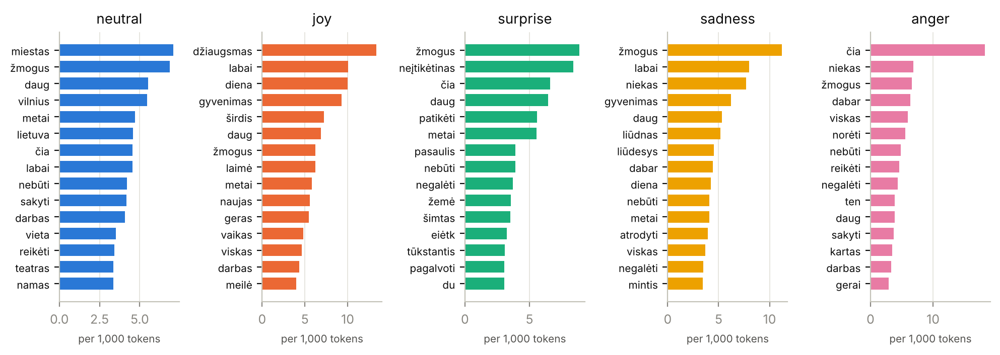
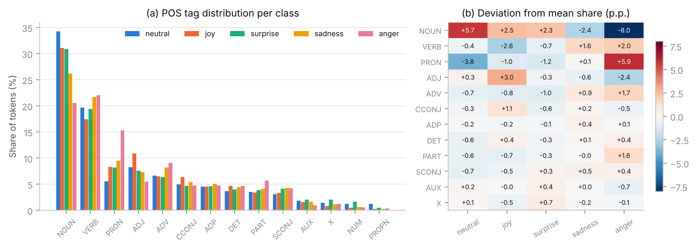
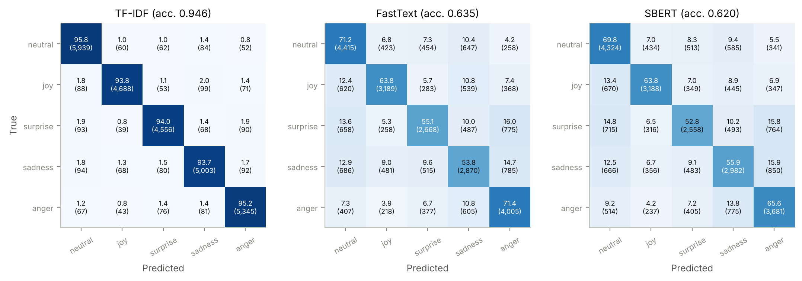
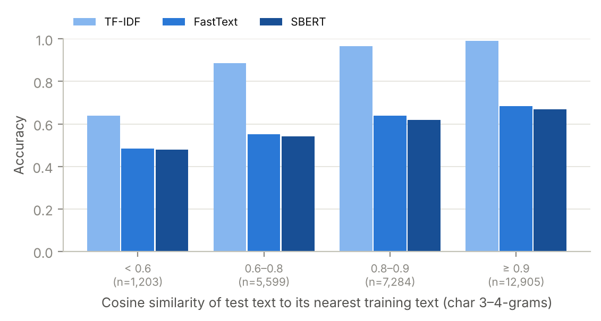

Natural Language Processing — Laboratory Work No. 5

Emotion Classification Using Machine Learning

Text analysis and Logistic Regression classification of the Lithuanian Emotional Speech Corpus (EMO) transcripts

Student: [Name Surname] Group: [Group] Lecturer: [Lecturer]

[University], [City] — 2026

# 1. Introduction

The aim of this work is to investigate emotion classification of Lithuanian text. The transcripts of the Lithuanian Emotional Speech Corpus (EMO) were turned into a five-class text dataset (neutral, joy, surprise, sadness, anger), the linguistic properties of the classes were analysed, and three text representations — TF-IDF, FastText word embeddings and Sentence-BERT embeddings — were compared as inputs to a Logistic Regression classifier. All processing was done in Python (pandas, spaCy, gensim, sentence-transformers, scikit-learn); the code is given in the Appendix.

# 2. Dataset preparation

`metadata.csv` contains one line per recording in the form `wav path | speaker id | transcript`. The emotion is encoded by the first directory of the path: **Z** = neutral, **D** = joy (*džiaugsmas*), **N** = surprise (*nustebimas*), **L** = sadness (*liūdesys*), **P** = anger (*pyktis*). Because the same sentence is read by several speakers, transcripts repeat many times. The preparation steps and their effect are summarised in Table 1.

Table: Table 1. Dataset preparation statistics.

| Step | Count |
|:--|--:|
| Recordings (rows) in `metadata.csv` | 349,696 |
| Unique transcripts | 135,214 |
| Texts associated with more than one emotion label (excluded) | **263** (244 with 2, 14 with 3, 5 with 4 labels) |
| Recordings belonging to these multi-label texts | 3,548 |
| Text samples **before** duplicate removal | **346,148** |
| Text samples **after** duplicate removal (final dataset) | **134,951** |

A text was treated as multi-label if the identical string occurs in folders of different emotions — such a sentence carries no emotion of its own (e.g., a short phrase read in several emotional styles), so it was removed entirely. Removing exact duplicates afterwards reduced the dataset by 61 %, leaving 134,951 unique texts, saved as `emo_text_dataset.csv`. Figure 1 shows the class distribution before and after duplicate removal: the final dataset is reasonably balanced, from 24,228 surprise texts (18.0 %) to 30,982 neutral texts (23.0 %); joy has 24,997 (18.5 %), sadness 26,687 (19.8 %) and anger 28,057 (20.8 %). Neutral texts were repeated by fewer speakers, so they shrink least.

{width=58%}

# 3. Text analysis

**Text length.** All texts are short (2–28 words, mean 7.3). Figure 2 shows that the length distributions of the five classes almost coincide: all peak at 3–5 words and have a long right tail. Neutral texts are slightly longer (mean 7.7, median 7 words) — they are mostly news-style sentences — while sadness texts are the shortest (mean 6.8, median 6); joy (7.1), surprise (7.0) and anger (7.4) lie in between. The differences are below one word, so length alone is a weak cue for emotion.

{width=78%}

**Vocabulary.** Texts were lemmatised with the spaCy Lithuanian model `lt_core_news_md`; punctuation, one-letter tokens and stop words (the spaCy Lithuanian list of 1,314 words plus the auxiliary/modal verbs *būti, galėti, turėti, tapti*, which topped every class) were removed. Figure 3 shows the 15 most frequent lemmas per class and Figure 4 the corresponding word clouds. Several general words are frequent in every class — *žmogus* ('person'), *daug* ('many'), *metai* ('year'), *labai* ('very'), the negated *nebūti* ('not be') — but each class also has a clear lexical signature. Table 2 lists the most distinctive lemmas, ranked by the weighted log-odds ratio with an informative prior (each class versus the rest).

{width=92%}

Table: Table 2. Most distinctive lemmas of each class (weighted log-odds, top 8), with English glosses.

| Neutral | Joy | Surprise | Sadness | Anger |
|:--|:--|:--|:--|:--|
| vilnius | džiaugsmas 'joy' | neįtikėtinas 'incredible' | niekas 'nothing' | čia 'here' |
| miestas 'city' | širdis 'heart' | patikėti 'believe' | mintis 'thought' | eik 'go (imp.)' |
| teatras 'theatre' | diena 'day' | pagalvoti 'think' | liūdnas 'sad' | dabar 'now' |
| menas 'art' | laimė 'happiness' | žemė 'earth' | skausmas 'pain' | norėti 'want' |
| projektas 'project' | geras 'good' | augalas 'plant' | liūdesys 'sadness' | niekas 'nothing' |
| lietuva | gyvenimas 'life' | spalva 'colour' | jaustis 'feel' | velnias 'devil' |
| pastatas 'building' | gražus 'beautiful' | šimtas 'hundred' | prisiminimas 'memory' | pyktis 'anger' |
| savivaldybė 'municipality' | nuostabus 'wonderful' | girdėti 'hear' | sunkus 'heavy' | nesąmonė 'nonsense' |

Joy and sadness are dominated by explicit emotion words (*džiaugsmas, laimė, meilė* vs. *liūdnas, liūdesys, skausmas, ašara*). Surprise texts combine exclamations of disbelief (*neįtikėtina, nepatikėsi, oho*) with "did you know"-style facts about nature and numbers (*augalas, gyvūnas, žemė, šimtas, tūkstantis*). Anger texts are conversational — deictic adverbs (*čia, dabar*), imperatives (*eik*), insults and swearing (*kvailys, velnias, nesąmonė*). Neutral texts are news and culture reports (*Vilnius, savivaldybė, teatras, projektas*). Overlap of the 100 most frequent lemmas (Jaccard index) is highest for sadness–anger (0.37) and lowest for anger versus neutral and joy (0.21), i.e. the two negative emotions share the most vocabulary (*niekas, negalėti, nebūti*). Lexical diversity (type–token ratio of lemmas) is lowest for neutral (0.083) and joy (0.086), whose texts are more formulaic (congratulations, news), and highest for anger (0.112).

{width=100%}

**Part-of-speech distribution.** Universal POS tags assigned by the same spaCy model are compared in Figure 5. Neutral texts are the most nominal (34.3 % nouns, +5.7 p.p. above the class average) and contain the most proper nouns (together with surprise also the most numerals), as expected of informative news text. Moving from neutral through joy, surprise and sadness to anger, the share of nouns falls steadily (to 20.6 %) and the share of pronouns rises; verbs, adverbs and particles are most frequent in sadness and anger. Anger has 15.3 % pronouns — almost three times more than neutral (5.5 %) — reflecting direct address (*tu, tave, man*) and the dialogue-like nature of angry utterances. Joy has the most adjectives (10.9 %, e.g. *gražus, nuostabus, puikus*) and coordinating conjunctions, while sadness sits between surprise and anger, with more verbs, adverbs and subordinating conjunctions than the positive classes.

{width=92%}

Two limitations of the spaCy model should be noted: the transcripts are lower-case, so proper nouns are often tagged as nouns or adjectives, and some lemmas are wrong (e.g. the imperative *eik* 'go' is lemmatised to *eiėtk* instead of *eiti*). These errors are systematic and similar across classes, so they do not change the comparisons above.

# 4. Text representations

The dataset was split into a training set (80 %, 107,960 texts) and a test set (20 %, 26,991 texts) with stratified sampling (`random_state = 42`); class proportions are identical in both sets. Every data-dependent step — the TF-IDF vocabulary and IDF weights, FastText training, feature standardisation and the choice of the regularisation strength — used the training set only. Three representations were chosen, one from each category (Table 3).

1. **TF-IDF (frequency-based).** Word unigrams and bigrams of the raw lower-cased text (`min_df = 2`, `max_df = 0.5`, sublinear TF, L2 normalisation). Raw word forms were used instead of lemmas because Lithuanian inflection carries useful signal (person and mood of verbs, e.g. imperatives in anger) and pronouns, which are stop words, are strong cues (Figure 5). TF-IDF is a strong, transparent baseline for short texts with class-specific vocabulary.
2. **FastText (static embeddings).** A 300-dimensional skip-gram FastText model (window 5, character n-grams 3–6, 10 epochs) was trained with gensim on the training texts only; a text vector is the mean of its word vectors. FastText was chosen over Word2Vec/GloVe because Lithuanian is highly inflected: sub-word n-grams give vectors to unseen word forms and share information between forms of one lemma.
3. **Sentence-BERT (contextual embeddings).** The pretrained multilingual model `paraphrase-multilingual-MiniLM-L12-v2` (12 transformer layers, trained on 50+ languages including Lithuanian) encodes each text into a 384-dimensional vector by mean pooling of contextual token embeddings. It was chosen because it produces sentence-level vectors directly and runs on a CPU; it was used frozen (no fine-tuning).

Table: Table 3. Comparison of the text representations (computed on the full dataset).

| Property | TF-IDF | FastText | Sentence-BERT |
|:--|--:|--:|--:|
| Dimensionality | 126,679 | 300 | 384 |
| Sparsity (share of zeros) | 99.99 % | 0 % | 0 % |
| Non-zero values per text (mean) | 12.4 | 300 | 384 |
| Fitted on our data | vocabulary + IDF | whole model (33,757 words) | no (pretrained) |
| Word order / context | local (bigrams) | none (average) | full sentence context |
| Similarity of synonyms | none | morphological, partly semantic | semantic |
| Feature extraction time (CPU) | 3 s | 45 s | 375 s |

TF-IDF is extremely high-dimensional and sparse: each text activates only ~12 of 126,679 features, and every feature is an exact word or word pair, so synonyms and different inflections of the same word are unrelated. The two embedding methods are dense and low-dimensional (300–384 features, ~330× fewer). The nearest neighbours of FastText vectors show that it mainly captures morphology: *džiaugsmas* 'joy' is closest to its own case forms (*džiaugsmai, džiaugsmui, džiaugsmą*) and *kvailys* 'fool' to *kvaily, kvaila, kvailystė*, but *miestas* 'city' is also close to the rhyming *kviestas, sviestas* and *pyktis* 'anger' to other words ending in *-tis* (*keiktis* 'to swear', but also *suktis, žūtis*). With only ~0.8 M training tokens, its semantics is shallow, and averaging discards word order. Sentence-BERT is the only representation that models context and meaning at the sentence level (paraphrases receive similar vectors), but it was trained for semantic similarity, not emotion.

# 5. Emotion classification

For each representation a multinomial Logistic Regression (scikit-learn, L-BFGS, up to 3,000 iterations) was trained on the same training set and evaluated on the same test set. Dense embeddings were standardised. The inverse regularisation strength *C* was chosen from four values by macro-F1 on a 10 % validation part of the training set, and the final model was re-trained on the full training set. The results are given in Table 4 (precision, recall and F1 are macro-averaged; the classes are nearly balanced, so weighted averages differ by < 0.003), per-class F1 in Table 5 and the confusion matrices in Figure 6.

Table: Table 4. Classification results on the test set (26,991 texts).

| Representation | Dim. | *C* | Accuracy | Precision | Recall | F1-score |
|:--|--:|--:|--:|--:|--:|--:|
| TF-IDF (uni+bigrams) | 126,679 | 30 | **0.946** | **0.946** | **0.945** | **0.946** |
| FastText (mean) | 300 | 0.1 | 0.635 | 0.635 | 0.630 | 0.631 |
| Sentence-BERT (MiniLM) | 384 | 1 | 0.620 | 0.621 | 0.616 | 0.617 |

Table: Table 5. Per-class F1-score on the test set.

| Class | TF-IDF | FastText | Sentence-BERT |
|:--|--:|--:|--:|
| neutral | 0.952 | 0.680 | 0.661 |
| joy | 0.947 | 0.667 | 0.669 |
| surprise | 0.942 | 0.584 | 0.559 |
| sadness | 0.938 | 0.547 | 0.562 |
| anger | 0.949 | 0.679 | 0.635 |

{width=94%}

**TF-IDF performs best by a wide margin** (accuracy 0.946 vs. 0.635 and 0.620), and its errors are small and spread almost evenly over all class pairs (each ≤ 2 % of a class; the largest are joy→sadness, 99 texts, and sadness→neutral, 94). FastText is slightly better than Sentence-BERT, and the two embedding models make very similar errors. For them, **neutral and anger are the easiest classes and surprise and sadness the hardest** (F1 0.55–0.58). The most common errors are sadness→anger (15–16 % of sadness texts), surprise→anger (16 %), surprise→neutral (14–15 %), anger→sadness (14 % for Sentence-BERT) and joy→neutral (12–13 %). These mirror the text analysis: sadness and anger share negative, pronoun- and verb-rich vocabulary, surprise contains factual sentences that resemble neutral news, and joy texts without explicit emotion words fall back to neutral. Errors also concentrate in very short texts: for 1–3-word texts accuracy is 0.85 (TF-IDF) and 0.48 (Sentence-BERT), against 0.997 and 0.75 for texts of 16+ words. 3.2 % of test texts are misclassified by all three models — typically short fragments with no emotional content of their own, e.g. *ir gegužės vakarais* 'and in May evenings' (sadness, predicted joy) or *žvelgdami į dangų matote daugybę žvaigždžių* 'looking at the sky you see many stars' (joy, predicted sadness). In this corpus the label comes from the emotion in which the script was meant to be read, not necessarily from the meaning of each individual sentence.

**Why is TF-IDF so much better?** The corpus was built from a limited set of emotional scripts, each read by several speakers, and the transcripts of the same sentence differ slightly between recordings (word endings, a missing or extra word, e.g. *…kai galime paleisti…* / *…kai galima paleisti…*). Exact duplicate removal does not merge such variants, and a random split puts them on both sides. For every test text we computed the highest cosine similarity (character 3–4-grams) to any training text: 47.8 % of test texts have a training neighbour with similarity ≥ 0.9, and simply copying the label of the most similar training text already gives 95.6 % accuracy. TF-IDF with bigrams and weak regularisation (*C* = 30) exploits exactly these exact word overlaps. Figure 7 shows that its accuracy falls from 0.99 for near-duplicates to 0.64 for the 4.5 % of test texts without a close neighbour (< 0.6), while the embeddings fall from ~0.68 to ~0.48. Thus TF-IDF remains the best representation even for unseen sentences — the classes differ strongly in topic and vocabulary (Section 3) — but its 0.946 largely measures recognition of the source script, and the realistic accuracy for genuinely new texts is closer to 0.6.

{width=60%}

The embedding models are weaker for two reasons. Averaging FastText vectors and pooling Sentence-BERT tokens compress a text into a few hundred dimensions that encode its general topic, while the decisive cues are often single words (an insult, *liūdna*, *neįtikėtina*) that get diluted. In addition, the paraphrase-trained Sentence-BERT model is frozen and multilingual — it represents what a sentence is about rather than its emotional tone, and its Lithuanian coverage is limited — so a linear classifier on top of it is close to FastText trained on the data itself.

# 6. Conclusions

1. From 349,696 EMO transcripts, 263 texts with multiple emotion labels were excluded, and duplicate removal reduced 346,148 samples to 134,951 unique texts with a fairly balanced distribution over the five emotions (18–23 % per class).
2. Text length hardly differs between classes (means 6.8–7.7 words). Vocabulary and POS distributions differ clearly: neutral texts are nominal news-style sentences, joy and sadness use explicit emotion words, surprise mixes disbelief with facts, and anger is conversational with many pronouns, verbs and imperatives. Sadness and anger are the most similar classes.
3. TF-IDF (126,679 sparse dimensions) achieved the best results (accuracy and macro-F1 0.946), followed by FastText (0.635/0.631) and Sentence-BERT (0.620/0.617). The embedding models mostly confuse sadness/surprise with anger and surprise/joy with neutral.
4. Near-duplicate transcripts of the same sentence occur in both training and test sets and strongly inflate the TF-IDF score; on texts without a close training neighbour accuracy is 0.64 (TF-IDF) and 0.48 (embeddings). A fairer evaluation would group near-duplicate sentences before splitting, and fine-tuning a transformer on the emotion labels is the most promising way to improve the contextual representation.

# Appendix. Python code

The code is organised into five scripts, run in this order: `prepare_dataset.py` (Section 2), `text_analysis.py` (Section 3), `classify.py` (Sections 4–5) and `near_duplicate_analysis.py` (Figure 7); `common.py` holds shared settings. Python 3.13, pandas 3, spaCy 3.8 with `lt_core_news_md` 3.7, gensim 4.4, sentence-transformers 6.3, scikit-learn 1.9, PyTorch 2 (CPU).

